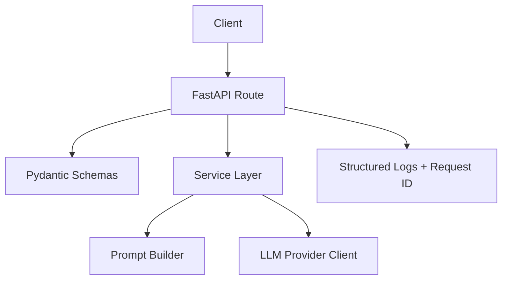

# ai-backend-production-starter

`ai-backend-production-starter` is a small, production-minded starter for FastAPI backends that call AI/LLM providers.

It is intended as a clean public showcase repository, not a full platform.

## Status

Version: `v0.1`

This repo is intentionally small. It demonstrates structure and production-minded defaults, not a complete AI platform.

## What This Repo Is

- A small FastAPI backend starter
- An example of route, service, schema, and core separation
- A simple baseline for environment-based config, structured logging, and request IDs
- A minimal example of keeping LLM provider access out of route handlers
- A testable structure where the LLM client can be replaced in tests

## What This Repo Is Not

- Not an auth system
- Not a database-backed application
- Not a RAG stack
- Not a queue or workflow system
- Not a multi-agent framework
- Not a complete production platform

## Architecture Overview



- `routes/` contains HTTP endpoint handlers
- `services/` contains prompt-building and LLM client logic
- `schemas/` contains typed Pydantic request and response models
- `core/` contains shared application exceptions
- `config.py` loads environment-based settings
- `middleware.py` generates request IDs and logs request completion
- `logging_config.py` sets up structured JSON logging

The `POST /v1/ai-tasks/analyze` endpoint accepts a small prompt payload, builds provider input in a service, and delegates the external call to `LLMClient`.

Tests can override that client dependency without calling a real external API.

## Folder Structure

```text
ai-backend-production-starter/
  README.md
  .env.example
  .dockerignore
  Dockerfile
  docker-compose.yml
  pyproject.toml

  src/
    ai_backend_starter/
      main.py
      config.py
      logging_config.py
      middleware.py

      routes/
      schemas/
      services/
      core/

  tests/
```

## Quick Start

```bash
uv sync
uv run uvicorn ai_backend_starter.main:app --reload
```

Then open:

```text
http://localhost:8000/health
```

## Environment Variables

Copy `.env.example` to `.env` and adjust values as needed.

| Variable | Purpose | Default |
|---|---|---|
| `APP_NAME` | FastAPI app name | `ai-backend-production-starter` |
| `APP_ENV` | Environment name | `development` |
| `APP_HOST` | Bind host | `0.0.0.0` |
| `APP_PORT` | Bind port | `8000` |
| `LOG_LEVEL` | Root log level | `INFO` |
| `OPENAI_API_KEY` | Provider API key | empty |
| `OPENAI_MODEL` | Provider model name | `gpt-4.1-mini` |

Secrets are read from environment variables only.

`.env.example` contains placeholders only.

## Local Run Commands

Install dependencies:

```bash
uv sync
```

Run the API:

```bash
uv run uvicorn ai_backend_starter.main:app --reload
```

## Test And Lint Commands

Run tests:

```bash
uv run pytest
```

Run linting:

```bash
uv run ruff check .
```

## Docker

Build the image:

```bash
docker build -t ai-backend-production-starter .
```

Run the image:

```bash
docker run --rm -p 8000:8000 --env-file .env ai-backend-production-starter
```

Run with Compose:

```bash
docker compose up --build
```

## Endpoints

- `GET /health`
- `POST /v1/ai-tasks/analyze`

### `GET /health`

```bash
curl http://localhost:8000/health
```

Example response:

```json
{"status":"ok"}
```

### `POST /v1/ai-tasks/analyze`

```bash
curl -X POST http://localhost:8000/v1/ai-tasks/analyze \
  -H "Content-Type: application/json" \
  -d "{\"prompt\":\"Summarize this text\",\"system_prompt\":\"Be concise\"}"
```

Example success response:

```json
{
  "text": "...",
  "model": "gpt-4.1-mini"
}
```

Example provider/config failure response:

```json
{
  "detail": "OPENAI_API_KEY is not configured."
}
```

## Structured Logging

The app logs request completion with a request ID, method, path, status code, and duration.

Example request log:

```json
{
  "asctime": "2026-05-15 07:44:39,897",
  "levelname": "INFO",
  "name": "ai_backend_starter.middleware",
  "message": "request completed",
  "request_id": "e4c489a5-f3d1-43b4-8f36-0076882fbf1b",
  "method": "GET",
  "path": "/health",
  "status_code": 200,
  "duration_ms": 0.97
}
```

Each response also includes an `x-request-id` header.

## Design Decisions

- Keep route handlers thin
- Keep provider access in a service class
- Use Pydantic schemas for typed request and response models
- Use dependency injection so tests can replace the LLM client
- Use environment variables for configuration and secrets
- Use structured JSON logging with request IDs
- Return a structured `503` response when the LLM provider is unavailable
- Keep the project intentionally small instead of hiding complexity behind unnecessary abstractions

## Limitations

- Only one provider client is included
- The request and response models are intentionally small
- Error handling is intentionally simple
- There is no persistence, auth, RAG, background processing, or queue system
- Uvicorn startup and access logs may still use Uvicorn's default formatting; application request logs are structured JSON

## Roadmap

- Add lightweight CI for lint and test checks
- Add a cleaner provider interface if more providers are introduced
- Expand test coverage for validation and failure cases
- Add optional type checking
- Add an example deployment configuration later, without turning this repo into an infrastructure platform