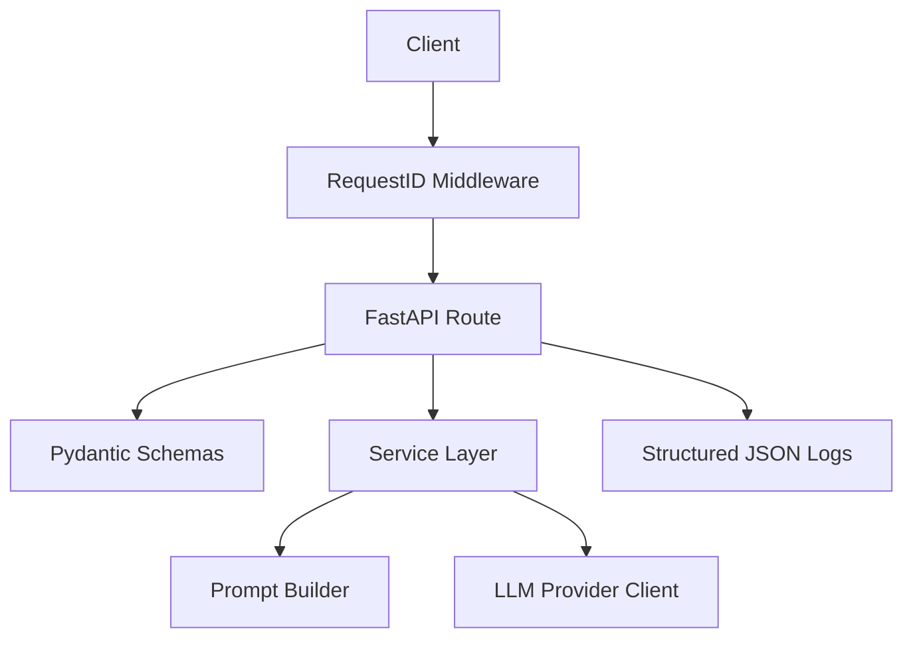

# ai-backend-production-starter

[](https://github.com/manuelblinkert/ai-backend-production-starter/actions/workflows/ci.yml)

A production-minded FastAPI starter for backends that call AI/LLM providers.

This is a public showcase repository, not a full platform. It demonstrates the structural patterns, operational defaults, and testing approach I apply when building AI backend services professionally.

## Status

Version: `v0.1` — intentionally small. It demonstrates structure and defaults, not a complete AI platform.

## Who Is This For

Backend engineers and AI systems architects who want a clean, minimal reference for:

- how to structure a FastAPI service that calls an LLM provider
- how to keep routes, services, schemas, and provider clients properly separated
- how to set up structured logging, request IDs, and error handling from the start
- how to write tests that stub the LLM client without hitting a real API

## What This Repo Demonstrates

- Route / service / schema separation with clear boundaries
- LLM provider access isolated in a service class, not in route handlers
- Pydantic schemas for typed request and response validation
- Environment-based configuration via `pydantic-settings`
- Structured JSON logging with per-request IDs propagated via `ContextVar`
- `x-request-id` header on every response (generated or forwarded)
- Structured `503` response when the LLM provider is unavailable
- Dependency injection so tests can replace the LLM client without mocking internals
- Docker and Compose setup with non-root container user and health check

## What This Repo Is Not

- Not an auth system
- Not a database-backed application
- Not a RAG stack
- Not a queue or workflow system
- Not a multi-agent framework
- Not a complete production platform

## Adapting This for a Real Project

Clone the repo and use it as your starting point:

1. Rename the package from `ai_backend_starter` to your project name — update `src/`, `pyproject.toml`, all imports, and the Dockerfile.
2. Replace `/v1/ai-tasks/analyze` with your actual use case endpoint.
3. Keep the route / service / schema separation as the project grows.
4. Add project-specific providers or workflows inside `services/`.
5. Add database, auth, or queues only when the real use case requires them — not upfront.

## Architecture Overview



- `routes/` — HTTP endpoint handlers (thin, no business logic)
- `services/` — prompt building and LLM client
- `schemas/` — Pydantic request and response models
- `core/` — shared application exceptions
- `config.py` — environment-based settings via `pydantic-settings`
- `middleware.py` — request ID generation and request completion logging
- `logging_config.py` — structured JSON logging setup

The `POST /v1/ai-tasks/analyze` endpoint accepts a prompt payload, builds provider input in a service, and delegates the external call to `LLMClient`. Tests override that client dependency without touching a real API.

## Folder Structure

```text
ai-backend-production-starter/
  README.md
  .env.example
  .dockerignore
  Dockerfile
  docker-compose.yml
  pyproject.toml

  src/
    ai_backend_starter/
      main.py
      config.py
      logging_config.py
      middleware.py

      routes/
      schemas/
      services/
      core/

  tests/
  .github/workflows/ci.yml
```

## Quick Start

```bash
uv sync
uv run uvicorn ai_backend_starter.main:app --reload
```

Then open:

```text
http://localhost:8000/health
```

## Environment Variables

Copy `.env.example` to `.env` and adjust values as needed.

| Variable | Purpose | Default |
|---|---|---|
| `APP_NAME` | FastAPI app name | `ai-backend-production-starter` |
| `APP_ENV` | Environment name | `development` |
| `APP_HOST` | Bind host | `0.0.0.0` |
| `APP_PORT` | Bind port | `8000` |
| `LOG_LEVEL` | Root log level | `INFO` |
| `OPENAI_API_KEY` | Provider API key | empty |
| `OPENAI_MODEL` | Provider model name | `gpt-4.1-mini` |

Secrets are read from environment variables only. `.env.example` contains placeholders only.

## Local Run Commands

Install dependencies:

```bash
uv sync
```

Run the API:

```bash
uv run uvicorn ai_backend_starter.main:app --reload
```

## Test and Lint

Run tests:

```bash
uv run pytest
```

Run linting:

```bash
uv run ruff check .
```

## Docker

Build and run:

```bash
docker build -t ai-backend-production-starter .
docker run --rm -p 8000:8000 --env-file .env ai-backend-production-starter
```

Run with Compose:

```bash
docker compose up --build
```

## Endpoints

### `GET /health`

```bash
curl http://localhost:8000/health
```

```json
{"status": "ok"}
```

### `POST /v1/ai-tasks/analyze`

```bash
curl -X POST http://localhost:8000/v1/ai-tasks/analyze \
  -H "Content-Type: application/json" \
  -d '{"prompt": "Summarize this text", "system_prompt": "Be concise"}'
```

Success:

```json
{
  "text": "...",
  "model": "gpt-4.1-mini"
}
```

Provider or config failure (503):

```json
{
  "detail": "OPENAI_API_KEY is not configured."
}
```

## Structured Logging

Every request logs a completion entry with request ID, method, path, status code, and duration. The `x-request-id` header is present on every response.

```json
{
  "asctime": "2026-05-15 07:44:39,897",
  "levelname": "INFO",
  "name": "ai_backend_starter.middleware",
  "message": "request completed",
  "request_id": "e4c489a5-f3d1-43b4-8f36-0076882fbf1b",
  "method": "GET",
  "path": "/health",
  "status_code": 200,
  "duration_ms": 0.97
}
```

## Design Decisions

- Route handlers are thin — no business logic, no provider calls
- Provider access lives in a service class behind a dependency-injected interface
- Pydantic schemas enforce typed request and response contracts
- `LLMClient` is injected via `Depends()` so tests can swap it without mocking internals
- Configuration and secrets come from environment variables only
- Structured JSON logging with request IDs from the start, not as an afterthought
- `503` responses are structured and include the same `x-request-id` as successful responses
- Intentionally small — complexity is not hidden behind abstractions

## Limitations

- Only one provider client (OpenAI Responses API)
- Request and response models are intentionally minimal
- Error handling covers the provider-unavailable case; edge cases are not exhaustive
- No persistence, auth, RAG, background processing, or queue system
- Uvicorn access logs use Uvicorn's default format; application logs are structured JSON

## Roadmap

- Add a cleaner provider interface if more providers are introduced
- Expand test coverage for validation and failure edge cases
- Add optional type checking pass with mypy
- Add an example deployment configuration
